# ResQNet & Eldercare — Workflow Overview

This document defines the end-to-end operational workflows for emergency management, assistance intake, priority triage, resource matching, and response tracking.

---

## 1. ResQNet CAD Workflow Overview Diagram

The diagram below visualizes the two primary operational pipelines in ResQNet:
* **Flow A (Citizen Assistance & Resource Intake)**: Citizen registration, ambulance booking, automated matching, and unit release.
* **Flow B (Emergency Response & CAD Dispatch)**: Instant SOS triage, priority-queue ranking, CAD alert dispatch, and field incident resolution.

```mermaid
flowchart LR
    subgraph FlowA["A. CITIZEN ASSISTANCE & AMBULANCE REQUEST FLOW"]
        direction TB
        A1["1. Register & Profile
Add citizen/volunteer details, contacts, and availability."]
        A2["2. Create Request
Select emergency category (Medical, Fire, Flood, Accident) and enter location."]
        A3["3. Prioritise
PriorityQueue ranks requests by severity (Critical, High, Medium, Low)."]
        A4["4. Match & Assign
Matching engine assigns nearest available resource and volunteer."]
        A5["5. Response Progression
Track status: Pending -> Resource Assigned -> Responding -> On Site."]
        A6["6. Close & Save
Release resources/volunteers; persist audit log to SQLite storage."]
        A1 --> A2 --> A3 --> A4 --> A5 --> A6
    end

    subgraph FlowB["B. EMERGENCY RESPONSE & CAD DISPATCH FLOW"]
        direction TB
        B1["1. Trigger Event
Direct emergency SOS, public ambulance booking, or hotline (112)."]
        B2["2. Create Incident
Record emergency ID, location coordinates, affected people, and triage data."]
        B3["3. Dispatch Alert
Distress queue notification sent to CAD operator dispatch center."]
        B4["4. Track Delivery
Monitor assigned ambulance vehicle and volunteer response en route."]
        B5["5. Check Response
Verify unit arrival on site; if delayed, reassign available backup units."]
        B6["6. Record Outcome
Log resolution outcome, mark incident Resolved, and release units."]
        B1 --> B2 --> B3 --> B4 --> B5 --> B6
    end

    %% Color scheme matching workflow specification
    style FlowA fill:#E6F4F1,stroke:#2D7D75,stroke-width:2px,color:#134E48
    style FlowB fill:#FDF2EC,stroke:#C05C3D,stroke-width:2px,color:#7C2D12

    style A1 fill:#EAF7F2,stroke:#3B7A57,stroke-width:1.5px,color:#1B4332
    style A2 fill:#EAF7F2,stroke:#3B7A57,stroke-width:1.5px,color:#1B4332
    style A3 fill:#FEF8E7,stroke:#D4A017,stroke-width:1.5px,color:#5A4300
    style A4 fill:#EBF3FB,stroke:#3B82F6,stroke-width:1.5px,color:#1E3A8A
    style A5 fill:#EAF7F2,stroke:#3B7A57,stroke-width:1.5px,color:#1B4332
    style A6 fill:#F3EEF9,stroke:#8B5CF6,stroke-width:1.5px,color:#4C1D95

    style B1 fill:#FDF0EC,stroke:#E06D53,stroke-width:1.5px,color:#7C2D12
    style B2 fill:#FDF0EC,stroke:#E06D53,stroke-width:1.5px,color:#7C2D12
    style B3 fill:#EBF3FB,stroke:#3B82F6,stroke-width:1.5px,color:#1E3A8A
    style B4 fill:#FEF8E7,stroke:#D4A017,stroke-width:1.5px,color:#5A4300
    style B5 fill:#EAF7F2,stroke:#3B7A57,stroke-width:1.5px,color:#1B4332
    style B6 fill:#F3EEF9,stroke:#8B5CF6,stroke-width:1.5px,color:#4C1D95
```



---

## 2. Eldercare Workflow Overview Diagram (Reference Specification)

The exact specification for eldercare and assisted monitoring workflows:

```mermaid
flowchart LR
    subgraph FlowA["A. ASSISTANCE REQUEST FLOW"]
        direction TB
        A1["1. Register people
Add elder details, emergency contacts and caregiver availability."]
        A2["2. Create request
Select the assistance category and enter request details."]
        A3["3. Prioritise
PriorityQueue places urgent requests ahead of routine requests."]
        A4["4. Assign caregiver
Assign an available caregiver; otherwise keep the request queued."]
        A5["5. Perform service
Track ASSIGNED, IN_PROGRESS and COMPLETED status."]
        A6["6. Close and save
Release caregiver; update history, activity log and supported storage."]
        A1 --> A2 --> A3 --> A4 --> A5 --> A6
    end

    subgraph FlowB["B. EMERGENCY RESPONSE FLOW"]
        direction TB
        B1["1. Trigger event
Manual SOS, or a HeartGuard simulated critical condition for an enabled elder."]
        B2["2. Create incident
Record elder, source, reason and time; prevent duplicate active incidents."]
        B3["3. Dispatch alert
Notify configured responders using alert tasks and existing TCP support."]
        B4["4. Track delivery
Record delivery outcome separately from caregiver acknowledgment."]
        B5["5. Check response
If acknowledged, track response; if timeout expires, notify backup responders."]
        B6["6. Record outcome
Log acknowledgment/escalation and keep the incident open until resolved."]
        B1 --> B2 --> B3 --> B4 --> B5 --> B6
    end

    %% Styles matching reference image
    style FlowA fill:#EAF5F2,stroke:#2D7D75,stroke-width:2px,color:#134E48
    style FlowB fill:#FAF0EB,stroke:#C05C3D,stroke-width:2px,color:#7C2D12

    style A1 fill:#EDF7F4,stroke:#3B7A57,stroke-width:1.5px,color:#1B4332
    style A2 fill:#EDF7F4,stroke:#3B7A57,stroke-width:1.5px,color:#1B4332
    style A3 fill:#FFF9E6,stroke:#D4A017,stroke-width:1.5px,color:#5A4300
    style A4 fill:#EEF4FC,stroke:#3B82F6,stroke-width:1.5px,color:#1E3A8A
    style A5 fill:#EDF7F4,stroke:#3B7A57,stroke-width:1.5px,color:#1B4332
    style A6 fill:#F5EFFB,stroke:#8B5CF6,stroke-width:1.5px,color:#4C1D95

    style B1 fill:#FDF2EE,stroke:#E06D53,stroke-width:1.5px,color:#7C2D12
    style B2 fill:#FDF2EE,stroke:#E06D53,stroke-width:1.5px,color:#7C2D12
    style B3 fill:#EEF4FC,stroke:#3B82F6,stroke-width:1.5px,color:#1E3A8A
    style B4 fill:#FFF9E6,stroke:#D4A017,stroke-width:1.5px,color:#5A4300
    style B5 fill:#EDF7F4,stroke:#3B7A57,stroke-width:1.5px,color:#1B4332
    style B6 fill:#F5EFFB,stroke:#8B5CF6,stroke-width:1.5px,color:#4C1D95
```



> **Note**: *HeartGuard and acknowledgment-based escalation are proposed extensions unless verified in the running application.*

---

## 3. Side-by-Side Step Comparison Table

| Step | A. Assistance Request Flow | B. Emergency Response Flow |
|:---:|:---|:---|
| **1** | **Register people**<br>Add person details, emergency contacts, and volunteer/caregiver availability. | **Trigger event**<br>Manual SOS trigger, direct helpline intake, or automated sensor alert. |
| **2** | **Create request**<br>Select assistance/incident category and enter location & requirement details. | **Create incident**<br>Record source, timestamp, location, and reason; deduplicate active incidents. |
| **3** | **Prioritise**<br>`PriorityQueue` ranks critical and high-urgency requests ahead of routine requests. | **Dispatch alert**<br>Notify configured emergency dispatchers, CAD operators, and responder units. |
| **4** | **Assign resource / caregiver**<br>Match nearest available unit or volunteer; otherwise retain in priority queue. | **Track delivery**<br>Track responder dispatch and en-route transit separately from field acknowledgment. |
| **5** | **Perform service / Respond**<br>Track progression through `ASSIGNED`, `RESPONDING`, and `ON_SITE` states. | **Check response**<br>Verify arrival; if timeout expires without check-in, alert secondary backup units. |
| **6** | **Close and save**<br>Mark `RESOLVED`, release unit/caregiver, update history log, and persist to SQLite. | **Record outcome**<br>Log acknowledgment/escalation audit record and close incident upon full resolution. |

---

## 4. State Transition Life Cycle

```text
[Citizen SOS / Booking Intake]
            │
            ▼
        [PENDING]  ──(Priority Ranking in Queue)
            │
            ▼
    [Match & Assign]  ──(MatchingEngine: Distance & Availability)
            │
            ▼
   [RESOURCE_ASSIGNED]
            │
            ▼
      [RESPONDING]   ──(Unit en route to Sector)
            │
            ▼
       [ON_SITE]     ──(First responders / Caregivers arrived)
            │
            ▼
       [RESOLVED]    ──(Incident closed, resources released to pool)
```

---

## 5. Technology Architecture

* **Frontend**: React 18, Vite, React Router v6, Lucide Icons, Leaflet GPS Maps.
* **Backend**: Java 17, `com.sun.net.httpserver.HttpServer`, Multi-threaded Executor pool.
* **Storage & Persistence**: SQLite 3 (`data/resqnet.db`), CSV legacy import support (`data/`).
* **CAD Matching**: Proximity-weighted scoring (inverse Euclidean coordinate distance or location similarity).

